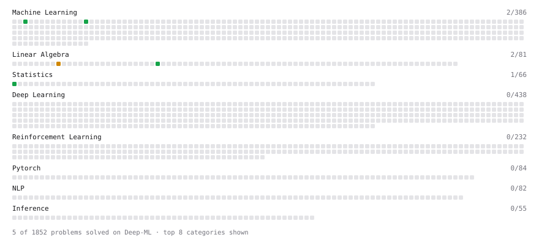

# Deep-ML

My machine learning practice from [Deep-ML](https://www.deep-ml.com). Every solution here was written by hand.

**4** solved · 4 problems · 0 labs · 0 math

[**Browse the interactive portfolio**](https://vineethpilli.github.io/deep-ml/) to replay this filling in over time.

## Problems

| | Difficulty | Solved | |
| --- | --- | --- | --- |
| [Calculate Cosine Similarity Between Vectors](https://www.deep-ml.com/problems/76) | easy | 2026-10-30 | [solution](problems/0076-calculate-cosine-similarity-between-vectors) |
| [Calculate Covariance Matrix](https://www.deep-ml.com/problems/10) | easy | 2026-10-30 | [solution](problems/0010-calculate-covariance-matrix) |
| [Feature Scaling Implementation](https://www.deep-ml.com/problems/16) | easy | 2026-10-30 | [solution](problems/0016-feature-scaling-implementation) |
| [Matrix times Matrix ](https://www.deep-ml.com/problems/9) | medium | 2026-10-30 | [solution](problems/0009-matrix-times-matrix) |

---

_This file is regenerated by Deep-ML on every push._
